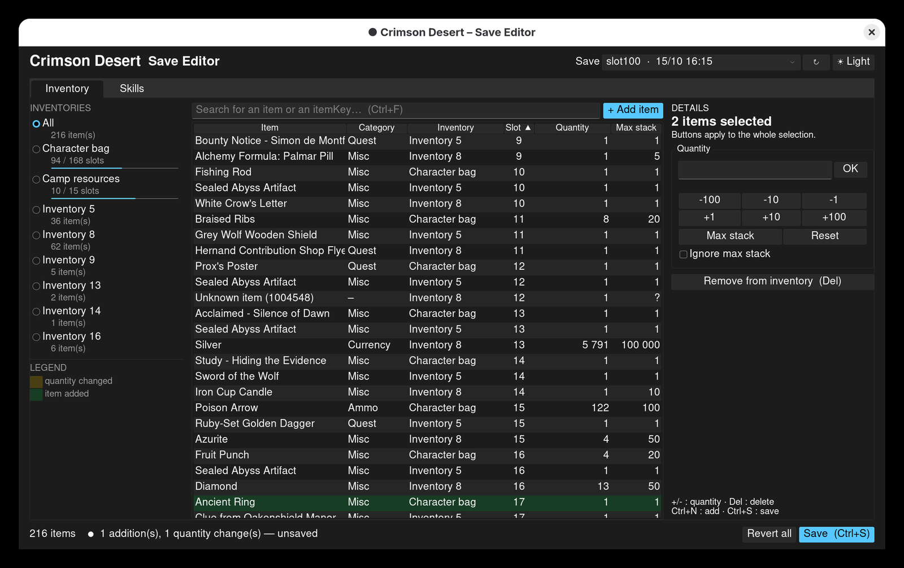
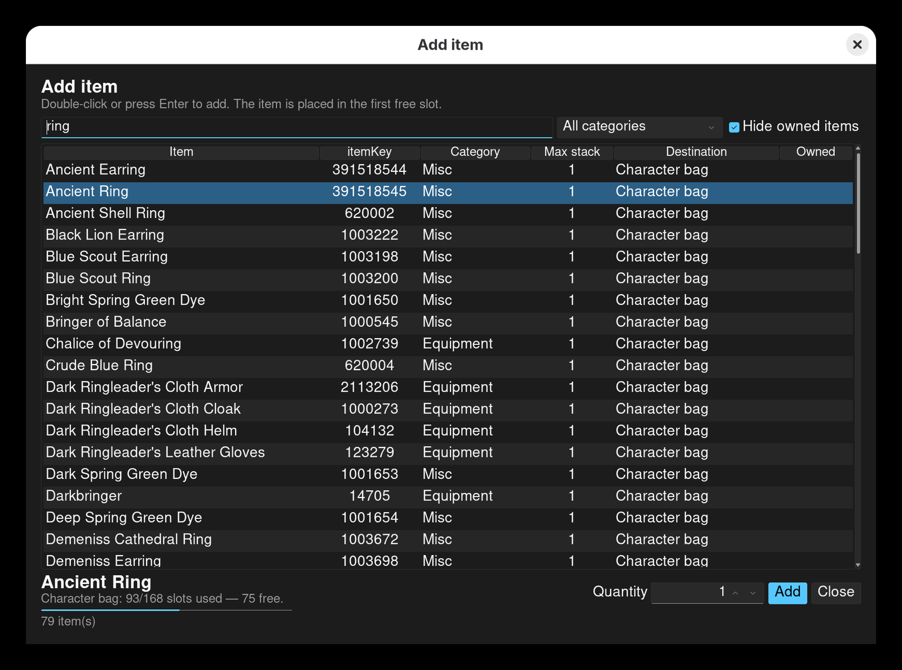
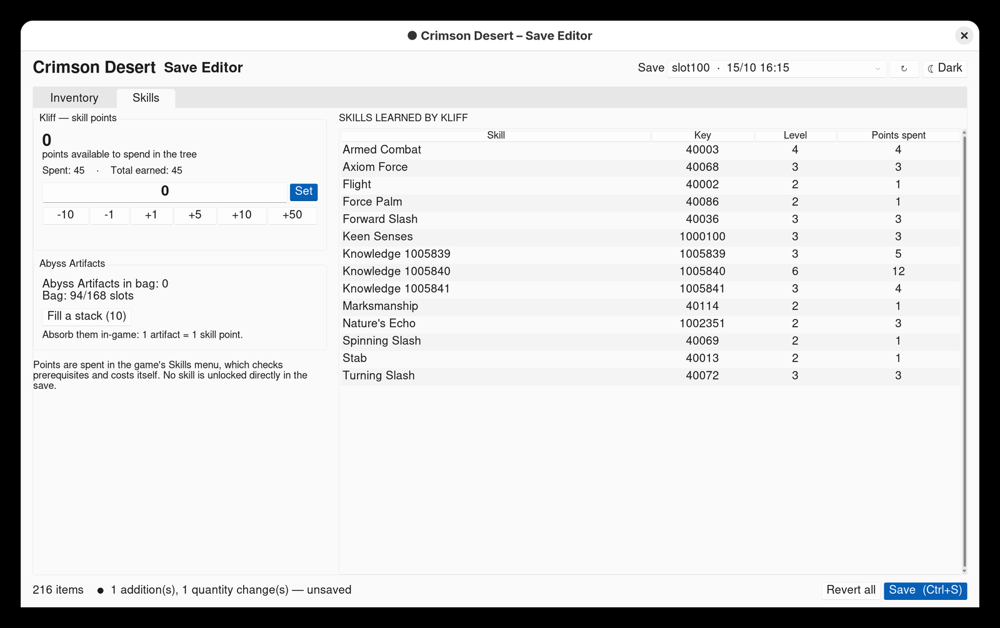
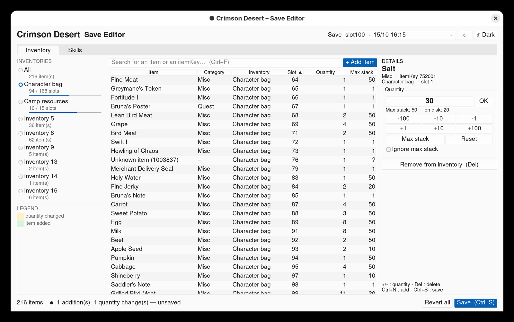

# Crimson Desert – Save Editor (Linux)

[](https://github.com/Vincent6785/Crimson_Desert_Save_Editor/actions/workflows/ci.yml)
[](LICENSE)

A **native Linux** save editor for Crimson Desert (Steam / Proton), written in Python with a Tkinter GUI.
No Windows DLL is needed, for reading or for writing. **Linux only**: Windows is deliberately refused.



## Features

- **Inventory**: change the quantity of any item (currency, camp resources, consumables…).
- **Add an item** that is not in the inventory, picked from a list of about 5,800 items. The editor checks that
  there is free space, and adds the item to the camp resources if it belongs there, otherwise to the character bag.
  Items that belong to other inventories are not offered.
- **Enchant level** of equipment, from +0 up to the item's own maximum (+10 for most weapons and armor).
- **Repair** damaged items (durability back to full).
- **Delete an item** from the inventory (except the last item of a sub-inventory, which the save format does not
  allow to empty).
- **Kliff's skill points**: set the number of available points (up to 999 in the interface). You then spend them in
  the game's Skills menu, which still enforces prerequisites and costs.
- Fill up a stack of **Abyss Artifact**.
- Light and dark themes, HiDPI-aware interface.
- **Automatic backup** of the save before every write, in
  `~/crimson_save_backups/<date_time>/<steam id>/<slot>/save.save`.
- Warning banner while the game is running.
- Keyboard shortcuts: `Ctrl+S` save · `Ctrl+N` add · `Ctrl+F` search · `Ctrl+Z` revert all · `+`/`-` quantity ·
  `Del` delete.

## Development environment

The project was developed and tested on:

| Component | Version |
|---|---|
| Arch Linux | rolling, October 2026 (kernel `7.2.8-arch1-2`) |
| Proton | Proton Hotfix `11.0-100` (`hotfix-20261007`) |
| Crimson Desert | `2.03.02` (Steam build `25474236`) |
| Python | `3.14.7`, Tk `8.6.16` |

CI also checks Python 3.10 and 3.13. Another game version may change the save format.

## Screenshots

| Add an item | Kliff's skill points |
|---|---|
|  |  |

Light theme, with pending changes highlighted before saving:



## Installation

Requirements: Python 3.10 or newer, with Tkinter (`tk` on Arch, `python3-tk` on Debian/Ubuntu,
`python3-tkinter` on Fedora).

```bash
git clone https://github.com/Vincent6785/Crimson_Desert_Save_Editor.git
cd Crimson_Desert_Save_Editor
python3 -m venv .venv
.venv/bin/pip install -r requirements.txt
./run.sh
```

Saves are looked up in the game's Proton prefix, in every declared Steam library (`libraryfolders.vdf`), for both
native and Flatpak Steam:
`<library>/steamapps/compatdata/3321460/pfx/drive_c/users/steamuser/AppData/Local/Pearl Abyss/CD/save/`.
If yours are elsewhere, point the `CD_SAVE_DIR` variable at the `save` folder (a Steam id folder or a single slot
folder also works):

```bash
CD_SAVE_DIR=/path/to/CD/save ./run.sh
```

A command-line interface is also available:

```bash
.venv/bin/python cd_items.py list  PATH/save.save --filter silver
.venv/bin/python cd_items.py set   PATH/save.save --id N --count 50000   # N = "#" column from list
```

## ⚠️ Precautions

- **Close the game** before saving: otherwise it will overwrite the save with its own version.
- **Disable Steam Cloud** for the game, or pick the **local** version if Steam reports a conflict.
- Try it on a secondary slot first. After an edit, load the game and let it save once before editing again.
- **Avoid mass additions.** Adding dozens of copies of a non-stackable item, or absurd quantities, has already made
  saves impossible to load. The editor refuses more than 10 unsaved copies of the same non-stackable item, and
  "Sealed Abyss Artifact" items are blocked.
- To restore a save, copy `~/crimson_save_backups/<date_time>/<steam id>/<slot>/save.save` back to
  `…/Pearl Abyss/CD/save/<steam id>/<slot>/save.save` (game closed).

**Single-player** only. Unofficial tool, not affiliated with Pearl Abyss. Use at your own risk.

## Files

| File | Purpose |
|---|---|
| `cd_items.py` | Save encryption and decryption (ChaCha20 + LZ4 + HMAC), `list` / `set` CLI |
| `cd_inventory.py` | Structure decoding, adding and removing items (with offset and block-table updates) |
| `cd_skills.py` | Reading and changing skill points |
| `cd_items_gui.py` | Graphical interface |
| `linux_only.py` | Stops the tool on Windows, before any dependency is loaded |
| `tests/` | Checks that need no real save (`python -m unittest discover -s tests`) |
| `items_db.json` | Item names, categories, max stacks, native inventories and max enchant levels |
| `knowledge_names.json` | Skill / knowledge names |

## Credits and license

This project would not exist without **NattKh** and their
[CRIMSON-DESERT-SAVE-EDITOR-AND-GAME-MODS](https://github.com/NattKh/CRIMSON-DESERT-SAVE-EDITOR-AND-GAME-MODS)
(MPL-2.0). The save format (encryption, schema, structure), the item and knowledge name files and the maximum enchant
levels all come from their reverse-engineering work. The code in this repository is a pure-Python reimplementation
based on it.

If this editor is useful to you, please consider supporting NattKh:

- Patreon: <https://www.patreon.com/cw/RicePaddyCheater>
- Buy Me a Coffee: <https://buymeacoffee.com/sungoku>

This project is distributed under the **Mozilla Public License 2.0** (see `LICENSE`).
